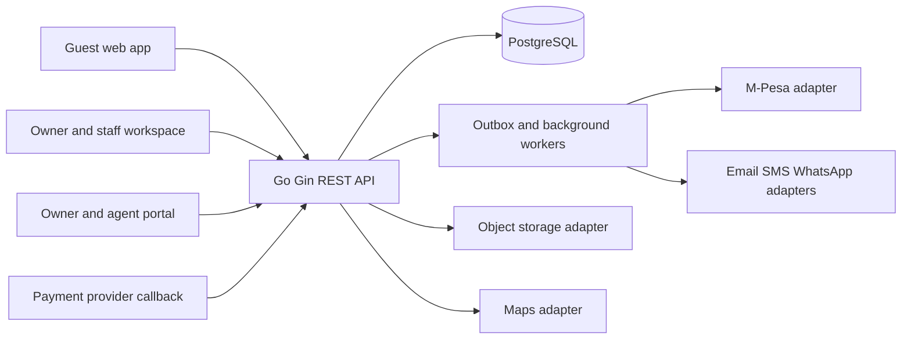

# Architecture

## System shape

Start as a modular monolith, not a set of independently deployed microservices.
The business workflows share transactional data, and a single API keeps the
first release operable while preserving clear module boundaries. Extract a
module only when measured scale or independent ownership justifies it.

## Project structure

```text
apps/web/                 Next.js public marketplace and role-based workspaces (planned)
services/api/cmd/api/     Go API entry point
services/api/internal/    HTTP, application, domain, and persistence packages (grow by module)
db/migrations/            Versioned PostgreSQL schema
docs/                     Architecture, schema, roadmap, API, and operations guides
infra/                    Deployment and observability configuration (planned)
```

The current executable slice is `services/api/internal/httpapi` plus the
PostgreSQL foundation migration. Keep web and provider adapters as clients of
the API; do not let them implement business rules independently.



The API is the only writer to business data. The browser never decides whether
a payment succeeded, whether a unit is available, or what an owner or agent is
owed. Provider callbacks are authenticated, persisted idempotently, and then
reconciled against the provider before a payment can be marked successful.

## Modules and boundaries

- Identity and access: users, business memberships, roles, permissions, sessions,
  password recovery, and audit events.
- Property catalog: businesses, locations, properties, bookable units, media,
  amenities, rates, and listing approval.
- Booking: availability search, reservation holds, guest details, lifecycle,
  cancellation, reviews, and enquiries.
- Money: payment intents and provider transactions, refunds, commissions,
  owner payouts, expenses, and statements. Amounts are decimal and currency is
  explicit; immutable ledger events are preferred over rewriting history.
- Operations: check-in/out, housekeeping, maintenance, inventory, and staff
  tasks, all scoped to a business and assigned properties.
- Engagement: promotions, referrals, reviews, notifications, newsletter
  subscriptions, attribution, and campaign analytics.
- Integrations: adapters isolate provider SDKs and credentials from domain
  logic. An outbox makes notifications and provider work retryable.
- Insights: read models and scheduled aggregation for dashboards and reports.
  These do not participate in booking or payment correctness.

## Tenancy and authorization

Every operational record belongs to a `business_id`. Users can join more than
one business through a membership. A membership role grants a set of permissions;
property-level assignments further limit owners, agents, and managers. The API
must resolve business and property scope from the authenticated principal and
must not trust a submitted `business_id` as proof of access. Super-admin access
is explicit, audited, and separate from ordinary business membership.

Guest checkout is supported by nullable user identity plus required booking
contact details. A guest account can later be linked only after verifying the
email or phone identity.

The first identity slice creates a business-owner membership during registration
and uses opaque, randomly generated, database-backed sessions. Only a SHA-256
digest of the session and CSRF tokens is stored. Mutating API requests require
the exact configured `APP_ORIGIN`; logout additionally requires the CSRF cookie
to match its request header and stored session digest. Production deployment
must use HTTPS and `COOKIE_SECURE=true`.

## Booking consistency

Properties contain bookable units so capacity and inventory are explicit. A
reservation row owns the occupied date range and has a PostgreSQL GiST exclusion
constraint. Creating a booking and its active reservation happens in one
transaction. The constraint is the final arbiter under concurrent requests;
availability search is advisory. Pending holds require an expiry worker that
releases stale reservations. Cancellation changes state and releases inventory
transactionally.

## Payments and financial records

The payment API creates a pending payment attempt and provider reference. It
does not accept a client-side success flag. A callback is signature-checked,
deduplicated by provider event/reference, and reconciled with the provider before
the payment and booking balances are updated. Sandbox mode is opt-in and cannot
be enabled in production. Refunds, commissions, and payouts are separate records
with their own statuses and references; they are not inferred from UI state.

Use an outbox table for work that must follow a committed transaction, such as
confirmation messages. Workers use bounded retries, idempotency keys, structured
logs, and dead-letter visibility. Never log passwords, tokens, full payment
credentials, or unnecessary personal data.

## API shape

Version REST endpoints under `/api/v1`. Validate and normalize input at the
transport boundary, authorize in application services, and keep persistence
behind repositories. Return stable machine-readable error codes and request
IDs. Publish OpenAPI with the API implementation. Important endpoint groups:

- `/auth`, `/me`, `/businesses`, `/members`, `/roles`
- `/properties`, `/units`, `/amenities`, `/availability`
- `/bookings`, `/bookings/{id}/cancel`, `/reviews`, `/enquiries`
- `/payments`, `/payments/{id}`, `/webhooks/{provider}`
- `/customers`, `/commissions`, `/payouts`, `/expenses`, `/reports`
- `/tasks`, `/maintenance`, `/notifications`

The initial executable API slice lives under `services/api`; it provides
`/api/v1/healthz` and a database-backed `/api/v1/readyz`. Domain routes are
introduced with their service and authorization tests in later roadmap phases.

## Security and operations

- Hash passwords with Argon2id or bcrypt using a maintained library; use secure,
  HttpOnly, SameSite cookies for browser sessions and CSRF protection for
  cookie-authenticated mutations.
- Apply permission checks and business/property scoping in every service;
  rate-limit authentication, search, and public enquiry routes.
- Use parameterized SQL, request-size limits, strict upload allowlists, signed
  upload URLs, and malware scanning where available.
- Configure CORS by environment, TLS at ingress, secrets outside source control,
  and least-privilege database/provider credentials.
- Record privileged and financial mutations in an append-only audit log.
- Use migrations, backups, restore drills, health/readiness endpoints, metrics,
  and structured logs before production use.

## Assumptions and decisions

- Initial deployment is for one operator but supports multiple businesses from
  the data model.
- A property may contain multiple independently bookable units; each booking
  reserves one unit. Multi-unit reservations can be added as a parent booking
  with multiple reservation lines without changing unit exclusivity.
- PostgreSQL is the source of truth. Search indexes and analytics are derived.
- M-Pesa Daraja is the first payment adapter. Card and bank-transfer providers
  implement the same provider interface. Real credentials and provider account
  approval are deployment prerequisites.
- Email, SMS, WhatsApp, cloud storage, maps, and AI features are optional
  adapters. Core discovery and booking must work without AI.
- No frontend or payment is production-ready until authentication, migration
  execution, authorization tests, provider callback verification, and deployment
  configuration are implemented and reviewed.