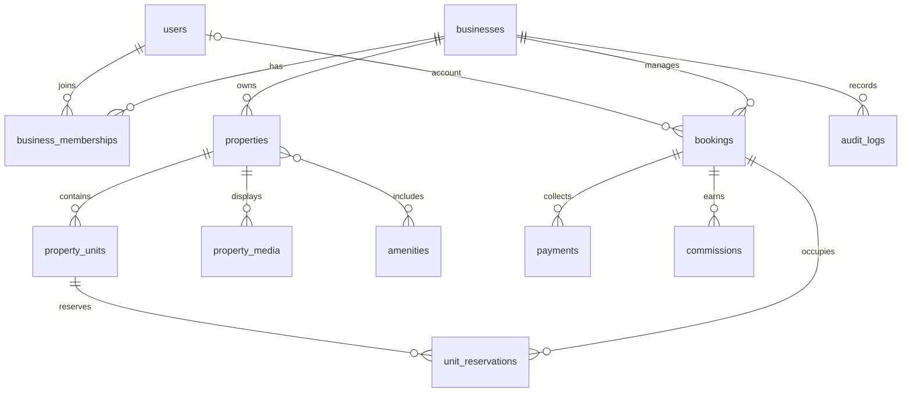

# Database Design

PostgreSQL is authoritative for identity, inventory, bookings, and financial
state. The initial migration is `db/migrations/0001_platform_foundation.sql`.
It is a starting schema for the first implementation phase, not a claim that all
product modules are already implemented.

## Core relationships

## Implemented foundation tables

| Area | Tables | Important rules |
| --- | --- | --- |
| Identity and tenancy | `users`, `businesses`, `business_memberships` | Unique email; unique membership per business; role/status constrained. |
| Inventory | `properties`, `property_units`, `property_media`, `amenities`, `property_amenities`, `property_rates` | Business scope on owned records; explicit unit capacity; rates use date ranges. |
| Guest and booking | `customers`, `bookings`, `unit_reservations` | Guest checkout allowed; positive date range and guest count; active inventory ranges cannot overlap. |
| Money | `payments`, `commissions` | Currency and decimal amount stored; provider references idempotent; payment and commission states constrained. |
| Governance | `audit_logs` | Actor, business scope, action, target, request metadata, and timestamp. |

## Planned relational extensions

These entities belong in subsequent migrations alongside their owning module:

- Authorization: `roles`, `permissions`, `role_permissions`, `user_sessions`,
  `password_reset_tokens`, and property-level `property_assignments`.
- Booking lifecycle: `booking_guests`, `cancellation_policies`, `refunds`,
  `reviews`, `enquiries`, and reservation expiry/outbox records.
- Financial operations: `transactions` or an append-only ledger, `payouts`,
  `expenses`, `commission_rules`, `discount_codes`, and reconciliation records.
- Operations: `tasks`, `cleaning_schedules`, `maintenance_requests`,
  `inventory_items`, `check_in_forms`, and `incidents`.
- Growth and communication: `promotions`, `referrals`, `newsletter_subscribers`,
  `notifications`, `notification_preferences`, and attribution events.
- Platform administration: `staff_activity`, `integration_configs` (secret
  values stored in a secret manager, not plaintext), and reporting aggregates.

## Integrity and indexing

- UUID primary keys are generated by PostgreSQL. All operational tables include
  creation/update timestamps; deletion is stateful for records that participate
  in money, bookings, or audit history.
- Foreign keys use restrictive deletion for financial and booking history.
- Search indexes cover business/property state, city, unit capacity, date ranges,
  booking status/date, customer email/phone, and provider references.
- A GiST exclusion constraint on active `unit_reservations` rejects intersecting
  half-open date ranges (`[check_in, check_out)`) for the same unit, including
  concurrent inserts. Pending reservations are active holds and must expire via
  a worker; cancelled, expired, and released reservations no longer block dates.
- Availability queries are not locks. The booking transaction inserts the
  reservation and handles exclusion violations as an availability conflict.
- Database row-level security may be added as defense in depth, but application
  authorization remains mandatory and connection pool tenant context must be
  reset safely.

## Migration and money conventions

Run migrations forward-only and review rollback implications before each
release. Store monetary values as `numeric(12,2)` with ISO 4217 currency codes;
do not use floating-point types. Record provider identifiers separately from
internal IDs. Payment callbacks must be idempotent and verified server-to-server.
Amounts and statuses should be changed through domain transactions, with audit
and ledger events retained for reconciliation.